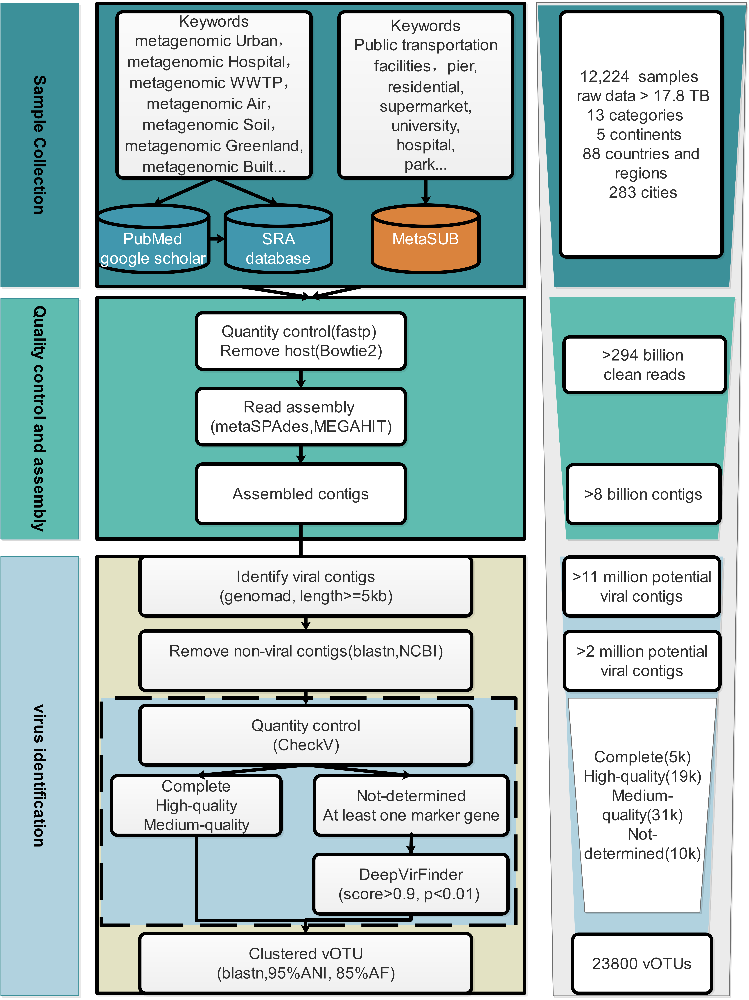

# Global Atlas of the Pan-Urban Virome (GPUV)

The current GPUV figure set covers **12,082 sequencing runs** from **372 city labels** across **85 countries or regions**. The curated DNA virome contains **22,494 viral operational taxonomic units (vOTUs)**. Individual analyses use the cohorts and denominators documented with the figures.

- [Current figures, plotting inputs and redraw instructions](current/README.md)
- [Figure methods and interpretation](current/METHODS.md)
- [Publication PDF assembly code](current/code/build_pdfs.py)

## Earlier repository release

The original repository materials below describe an earlier catalogue of 23,800 vOTUs. They provide the workflow context for the current figure set.

### Workflow
Here is the workflow of GPUV:

  

### Primary Software Applications

The following is a stepwise summary of the primary tools used in the GPUV analysis:

#### **1. Quality Control**
- [fastp](https://github.com/OpenGene/fastp) and [bowtie2](https://github.com/BenLangmead/bowtie2) were used to remove low-quality reads and trim adapter sequences. Reads originating from the host (e.g., human reference genome) were filtered out.

#### **2. Assembly**
- [metaSPAdes](https://github.com/ablab/spades) and [MEGAHIT](https://github.com/voutcn/megahit) were used for metagenomic assembly.

#### **3. Viral Identification and Quality Assessment**
- [geNomad](https://portal.nersc.gov/genomad/), [deepVirFinder](https://github.com/jessieren/DeepVirFinder) and [CheckV](https://bitbucket.org/berkeleylab/checkv) were used to identify viral contigs and Quality Control (QC).

#### **4. Statistical Analysis**
- Statistical analyses were performed using [R](https://www.r-project.org/) version 4.4.3, utilizing the [vegan](https://cran.r-project.org/package=vegan) package to calculate species diversity. Various R packages, including [ggplot2](https://ggplot2.tidyverse.org/), [pheatmap](https://cran.r-project.org/package=pheatmap), [ggpubr](https://cran.r-project.org/package=ggpubr), [ANCOMBC](https://github.com/FrederickHuangLin/ANCOMBC), and [VennDiagram](https://cran.r-project.org/package=VennDiagram), were employed to generate box plots, heatmaps, stacked bar plots, and Venn diagrams.  
- For statistical analyses, the [Wilcoxon rank-sum test](https://en.wikipedia.org/wiki/Mann–Whitney_U_test) was applied to assess differences between two groups, whereas [one-way analysis of variance (ANOVA)](https://en.wikipedia.org/wiki/Analysis_of_variance#One-way_ANOVA) was used for comparisons involving three or more groups. Statistical significance was defined as *p* < 0.05.
